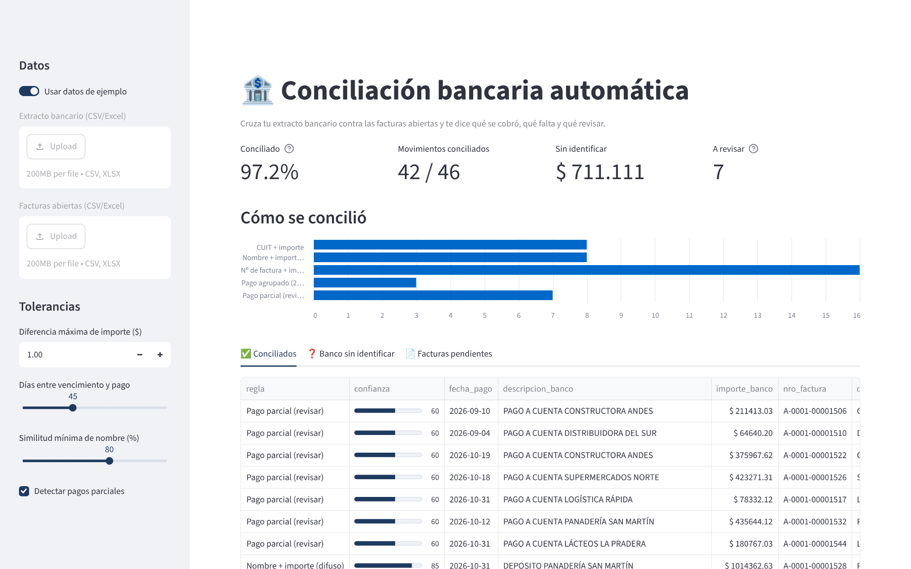
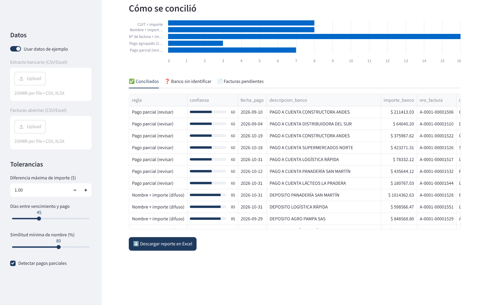

# 🏦 Conciliación bancaria automática

**Cruza el extracto bancario contra las facturas abiertas y te dice qué se cobró, qué falta y qué revisar.** En segundos, no en días.

Hecho por alguien que concilió cuentas a mano durante más de 10 años en multinacionales. Por eso el motor no "adivina": cada match dice con qué regla se hizo y qué tan seguro es.



## El problema

Todos los meses alguien del equipo de finanzas descarga el extracto, abre el listado de facturas y empieza a buscar: *¿esta transferencia de $ 714.656 de qué factura es?* Los clientes pagan con referencias incompletas, agrupan facturas en una sola transferencia o pagan a cuenta. Resultado: días de trabajo manual, errores y cobranzas que nadie sabe a qué imputar.

## Qué hace

Aplica **5 reglas en cascada**, de la más segura a la más flexible. Cada movimiento y cada factura se usan una sola vez:

| # | Regla | Ejemplo en el banco | Confianza |
|---|---|---|---|
| 1 | **Nº de factura + importe** | `TRANSF RECIBIDA ACME REF FC 1523` | 100 |
| 2 | **CUIT + importe** | `CRED TRANSF CUIT 30712345678 VARIOS` | 95 |
| 3 | **Nombre + importe (difuso)** | `DEPOSITO FERRETERIA EL TORNILLO` | 80-90 |
| 4 | **Pago agrupado** (2-3 facturas en un pago) | `TRANSF CUIT 30712345678 PAGO FACTURAS` | 85 |
| 5 | **Pago parcial** (se marca para revisar) | `PAGO A CUENTA CONSTRUCTORA ANDES` | 60 |

Detalles que importan en la vida real:

- **Tolerancia de importe** configurable, para los centavos de diferencia y los redondeos del banco.
- **Matching difuso de nombres** que ignora acentos, mayúsculas y formas societarias (`S.A.`, `S.R.L.`, `SAS`).
- **Nunca elige al azar**: si hay dos facturas iguales del mismo cliente, no concilia y te lo deja para revisar.
- **Pagos parciales con criterio FIFO**: se imputan a la factura más vieja del cliente.
- **Ignora débitos** (impuestos, comisiones) y separa los cobros que no se pudieron identificar.

## Resultado con los datos de ejemplo

```
  Conciliado: 97.2% del importe cobrado
  Movimientos: 42/46  ·  Facturas: 45/60
  Sin identificar: $ 711,111.23  ·  A revisar: 7
    - Nº de factura + importe: 16
    - CUIT + importe: 8
    - Nombre + importe (difuso): 8
    - Pago parcial (revisar): 7
    - Pago agrupado (2 facturas): 3
```

Y un Excel listo para el cierre ([ver ejemplo](docs/conciliacion_ejemplo.xlsx)) con 4 hojas: **Resumen**, **Conciliados** (con colores por nivel de confianza), **Banco sin identificar** y **Facturas pendientes**.



## Cómo usarlo

```bash
git clone https://github.com/varelajm10/conciliacion-bancaria.git
cd conciliacion-bancaria
pip install -r requirements.txt

# App web
streamlit run app.py

# Línea de comandos
python cli.py --demo
python cli.py --banco extracto.xlsx --facturas facturas.csv --salida conciliacion.xlsx --tolerancia 1 --ventana 45
```

O desde Python:

```python
import pandas as pd
from conciliador import conciliar, exportar_excel, Parametros

res = conciliar(pd.read_csv("extracto.csv"), pd.read_csv("facturas.csv"), Parametros(tolerancia_importe=1))
print(res.resumen)
exportar_excel(res, "conciliacion.xlsx")
```

### Formato de entrada

| Extracto bancario | Facturas abiertas |
|---|---|
| `id_mov`, `fecha`, `descripcion`, `importe` | `nro_factura`, `cliente`, `cuit`, `vencimiento`, `importe` |

Acepta CSV o Excel. Fechas en formato `dd/mm/aaaa`. Si tu banco o tu ERP (SAP, Tango, Odoo, etc.) exporta otros nombres de columna, se mapean en un par de líneas.

## Tests

```bash
pytest -q   # 11 tests: cada regla, ambigüedad, parciales, débitos, errores de formato y exportación
```

## Estructura

```
conciliador/
  core.py      # motor de reglas y normalización
  reporte.py   # exportación a Excel con formato
  demo.py      # generador de datos de ejemplo (100% inventados)
app.py         # interfaz web en Streamlit
cli.py         # línea de comandos
tests/
```

## Stack

Python · pandas · rapidfuzz · openpyxl · Streamlit · pytest

---

**¿Tu equipo pierde días conciliando?** Adapto este motor a tu banco, tu ERP y tus reglas de imputación.
Juan Manuel Varela · [Malt](https://www.malt.com/profile/juanmanuelvarela) · [Upwork](https://www.upwork.com/freelancers/~018e401f66a51ddd08) · [GitHub](https://github.com/varelajm10)

<sub>Los datos de ejemplo son ficticios: cualquier parecido con empresas reales es coincidencia.</sub>
